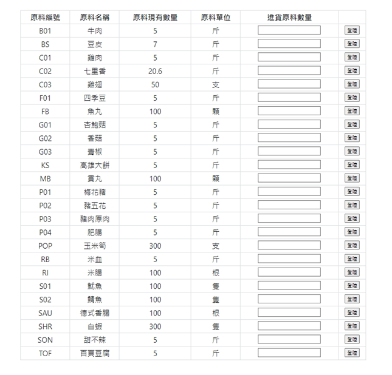
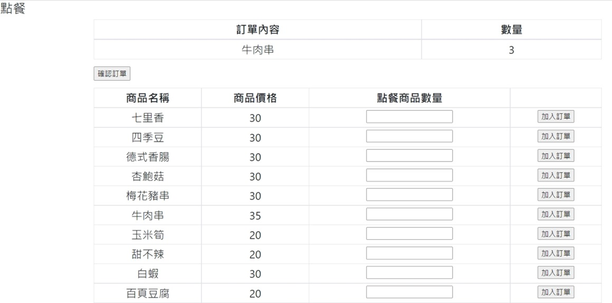
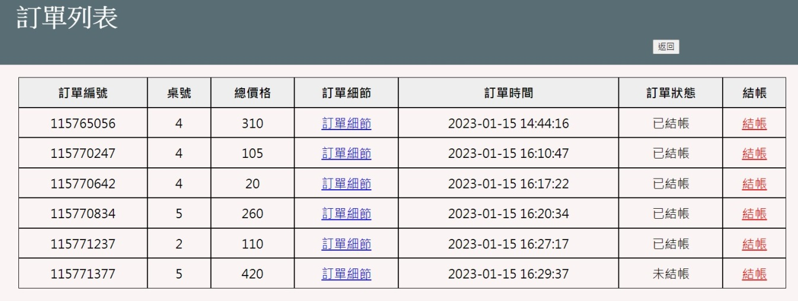

# Restaurant Management System

**University Database Systems Project | January 2023**

A web-based restaurant management system developed as a university team project at the Department of Computer Science and Information Engineering, National University of Tainan.

## Project Overview

This project was designed to improve the operational efficiency of a local restaurant that previously relied on paper-based records for inventory management, order processing, and daily sales calculations.

The system integrates ingredient management, product inventory, order management, and sales reporting into a centralized web application.

## Technologies

- **Frontend:** HTML, CSS, Bootstrap, JavaScript
- **Backend:** PHP
- **Database:** MySQL
- **Database Design:** ER Model, Relational Schema, Database Normalization

## Key Features

### 1. Ingredient Management
- Record ingredient purchases
- Track ingredient inventory
- Update remaining stock quantities

### 2. Product Management
- Record food preparation
- Track available product quantities
- Manage product inventory

### 3. Order Management
- Select dining table numbers
- Add products to customer orders
- Calculate order totals
- Update payment status

### 4. Sales Reporting
- View daily order counts
- Calculate daily sales revenue

## System Design

The database was designed using an Entity-Relationship Model and relational schema, with relationship tables connecting ingredients to products and products to orders.

## System Screenshots

### Main Dashboard

### Ingredient Management

### Order Management

### Checkout

## Project Documentation

See `docs/project-report.pdf` for the original project report, including system requirements, database design, workflow diagrams, and user documentation.

## Project Status

**Completed academic team project (2023).**

This repository preserves the original implementation for educational and portfolio purposes.

The project reflects the technologies and development practices used at the time. It has not been updated or security-hardened for production deployment.

The original database export is not currently included, so the application may not be directly runnable from this repository.

## Contributors

Developed as a university team project by three students.

Individual responsibilities and contributor information will be added after confirmation.

## Disclaimer

This project is provided as a historical academic work, not as a production-ready restaurant management solution.
